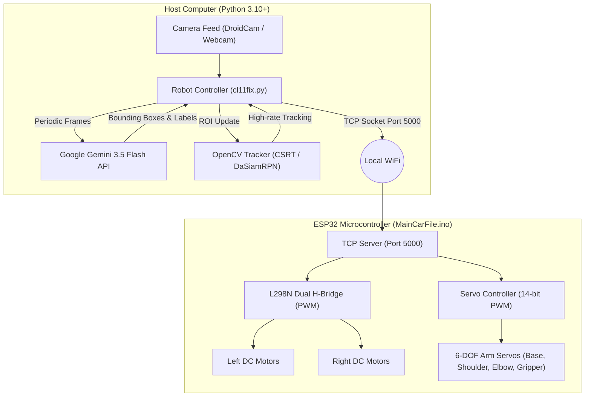
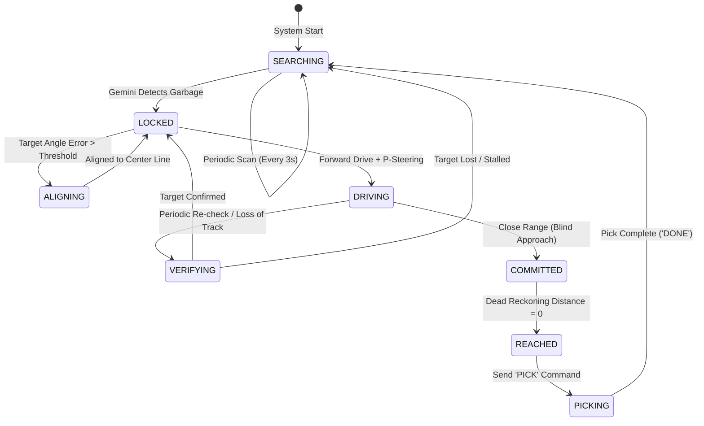

# 🤖 Smart Garbage Collecting Robot

An autonomous mobile robot designed for indoor litter detection, visual navigation, and automated retrieval. The system combines modern Multimodal AI (**Google Gemini 3.5 Flash**) for real-time vision understanding, **OpenCV** for low-latency visual tracking and dead-reckoning approach, and an **ESP32 microcontroller** for differential drive chassis control and a 6-DOF robotic manipulator arm.

---

## 🌟 Key Features

- **Hybrid Vision Architecture**: Decouples cloud-based multimodal LLM vision (~1-2s latency) from high-frequency real-time visual tracking (30+ FPS) using OpenCV trackers (CSRT/KCF/DaSiamRPN).
- **Google Gemini 3.5 Flash Integration**: Uses structured prompt engineering and JSON schema output to identify discarded litter (wrappers, cans, bottles, paper) while ignoring furniture and obstacles.
- **Dead Reckoning & Blind-Spot Navigation**: Estimates distance using calibrated focal-length or ground-plane bottom-edge projection, transitioning to dead reckoning (`speed × time`) when objects slip below the camera's field of view.
- **ESP32 WiFi TCP Server**: Real-time bidirectional control over WiFi with hardware PWM motor control, stall prevention, dynamic braking, and safety timeouts.
- **Smooth 6-DOF Manipulator**: Software-interpolated servo transitions (1° per 15ms) to prevent current spikes and mechanical jerk during the pick-and-place sequence.
- **Interactive Telemetry & HUD**: Live OpenCV display showing state machine modes, confidence ratings, estimated distances, and real-time debug telemetry.

---

## 🏗️ System Architecture



---

## 🔄 State Machine & Operational Flow



1. **SEARCHING**: The robot remains stationary and periodically triggers Gemini 3.5 Flash to scan the floor for garbage.
2. **LOCKED**: Once target coordinates are received, an OpenCV tracker takes over to lock onto the bounding box in real time.
3. **ALIGNING / DRIVING**: The controller performs turn-in-place bursts to align the robot's center line with the object, then drives forward while maintaining proportional steering.
4. **VERIFYING**: Intermittently pauses to re-verify the object using Gemini vision to prevent drift or false positives.
5. **COMMITTED (Dead Reckoning)**: As the robot gets very close (`< 35 cm`), the camera loses sight of the ground in front of the wheels. The robot commits to a straight drive based on calculated velocity and time.
6. **REACHED & PICK**: The robot halts and signals the ESP32 to execute the automated pickup routine.

---

## 🔌 Hardware Setup & Pinout

### 1. ESP32 Pin Assignment

| Subsystem | Component / Signal | ESP32 GPIO | Description |
|---|---|:---:|---|
| **Motor (L298N)** | ENA (Left PWM) | `GPIO 25` | Left motor speed (1 kHz PWM) |
| | IN1 | `GPIO 26` | Left motor direction A |
| | IN2 | `GPIO 27` | Left motor direction B |
| | ENB (Right PWM) | `GPIO 14` | Right motor speed (1 kHz PWM) |
| | IN3 | `GPIO 32` | Right motor direction A |
| | IN4 | `GPIO 33` | Right motor direction B |
| **Robotic Arm** | Base Servo | `GPIO 13` | Horizontal rotation / bin delivery |
| | Shoulder Servo | `GPIO 16` | Arm pitch elevation |
| | Elbow Servo | `GPIO 17` | Arm extension / reach |
| | Wrist Pitch | `GPIO 18` | Wrist angle (optional) |
| | Wrist Roll | `GPIO 19` | Wrist rotation (optional) |
| | Gripper Servo | `GPIO 21` | End-effector open/close |

> [!CAUTION]
> **Power Isolation**: Never power servos directly from the ESP32 3.3V or 5V pins. Servos demand high peak currents and must be powered by a dedicated 5V–6V power supply (e.g., 2S LiPo with a high-current UBEC/buck converter). **Ensure all grounds (ESP32, L298N, servo battery) are connected together.**

---

## 📡 TCP Protocol Specification

The ESP32 runs a TCP server on port `5000`. Messages are plain ASCII terminated by a newline (`\n`):

| Command | Direction | Description | Example Response |
|---|:---:|---|---|
| `M,<left>,<right>` | Host ➔ ESP32 | Set differential motor PWM (-200 to +200) | *(No response)* |
| `STOP` | Host ➔ ESP32 | Immediate motor brake and stop | *(No response)* |
| `PICK` | Host ➔ ESP32 | Triggers the automated pickup and drop sequence | `STARTED` ... `DONE` |
| `HOME` | Host ➔ ESP32 | Moves all arm servos to default home pose | `OK` |
| `ABORT` | Host ➔ ESP32 | Immediately halts arm motion | `ABORTED` |
| `PING` | Host ➔ ESP32 | Heartbeat check | `PONG` |

---

## 🚀 Quick Start Guide

### 1. Prerequisites

- Python 3.10+
- Arduino IDE (with ESP32 board definitions installed)
- [DroidCam](https://www.dev47apps.com/) or an external USB webcam

### 2. Repository Clone & Python Setup

```bash
git clone https://github.com/HanaanMakhdoomi/Smart-Garbage-Collecting-Robot.git
cd Smart-Garbage-Collecting-Robot

# Create virtual environment
python -m venv venv
venv\Scripts\activate      # Windows PowerShell / CMD

# Install dependencies
pip install google-genai opencv-contrib-python numpy python-dotenv
```

### 3. API Key & Environment Configuration

Copy the example `.env` file and insert your Gemini API Key:

```bash
cp .env.example .env
```

Edit `.env`:
```env
GEMINI_API_KEY=your_gemini_api_key_here
```

### 4. ESP32 Firmware Upload

1. Open `MainCarFile/MainCarFile.ino` in Arduino IDE.
2. Select **ESP32 Dev Module** as your target board.
3. Update your WiFi credentials:
   ```cpp
   const char* WIFI_SSID = "Your_WiFi_SSID";
   const char* WIFI_PASSWORD = "Your_WiFi_Password";
   ```
4. Flash the code to the ESP32.
5. Open Serial Monitor (115200 baud) to view the assigned IP address (e.g. `192.168.1.100`).

### 5. Run the Autonomous Robot Controller

1. Update `ESP32_IP` in `cl11fix.py` to match your ESP32's IP.
2. Start the vision controller:
   ```bash
   python cl11fix.py
   ```

---

## ⌨️ Runtime Keyboard Controls

When the OpenCV window is focused:

| Key | Action |
|:---:|---|
| `SPACE` | Force trigger an instant Gemini scan / re-verification |
| `R` | Release current target lock and reset state to searching |
| `P` | Manually test the arm pick sequence |
| `T` | Run straight test-drive calibration for speed measurement |
| `Q` / `ESC` | Safe emergency stop and quit application |

---

## 📐 Calibration & Tuning

### Distance Calibration
- **Width Method**: Update `KNOWN_OBJECT_WIDTH_CM`, `CALIBRATION_DISTANCE_CM`, and `CALIBRATION_WIDTH_PX` in `cl11fix.py`.
- **Bottom-Edge Ground Projection**: Set `USE_BOTTOM_EDGE_DISTANCE = True` and populate `Y2_CALIBRATION` with bottom-edge pixel coordinates ($y_2$) vs. measured distances (cm).

### Speed Calibration
Press `T` while running `cl11fix.py` to drive forward for 2.0 seconds. Measure the distance driven in cm and set:
$$\text{CAR\_SPEED\_CM\_PER\_S} = \frac{\text{Distance Measured (cm)}}{2.0}$$

---

## 🛡️ License

This project is licensed under the [MIT License](LICENSE).
